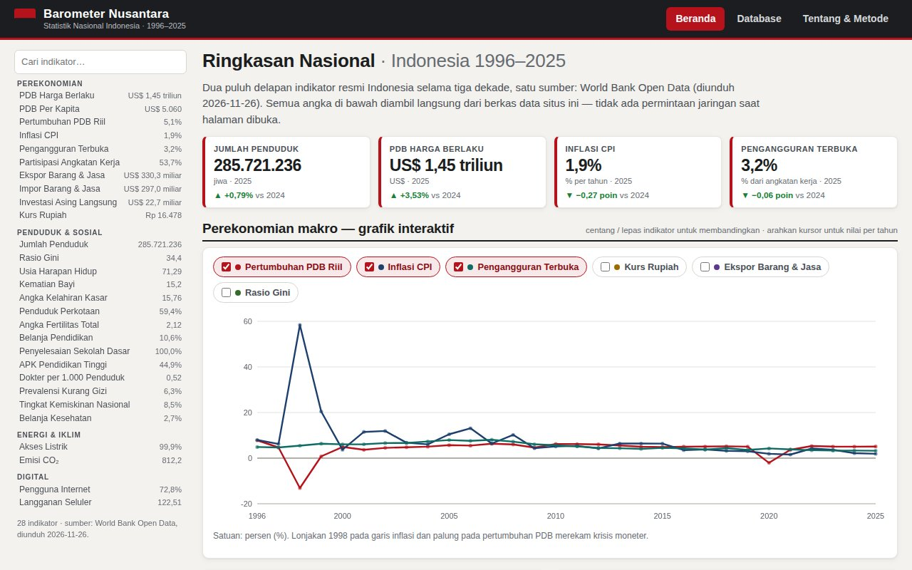

<p align="center">
  <a href="https://make.fun/bounty/best-national-statistics-site-20261126-0539?utm_source=github&utm_medium=readme&utm_campaign=best-national-statistics-site-20261126-0539"></a>
  <a href="https://make.fun/bounty/best-national-statistics-site-20261126-0539?utm_source=github&utm_medium=readme&utm_campaign=best-national-statistics-site-20261126-0539"></a>
  <a href="https://make.fun/bounty/best-national-statistics-site-20261126-0539?utm_source=github&utm_medium=readme&utm_campaign=best-national-statistics-site-20261126-0539"></a>
</p>

# Barometer Nusantara — Portal Statistik Nasional Indonesia

A working national statistics portal for Indonesia: **28 official indicators, 1996–2025**, frozen from the
World Bank Open Data API (fetch 2026-11-26) and shipped as a pure static site. Open it from disk or a LAN
server — **zero network requests at runtime**: no CDNs, no fonts, no libraries, no trackers.



## What's inside

| Route | Contents |
|---|---|
| `#/` | Ringkasan Nasional — 4 live KPI tiles with YoY delta arrows, interactive multi-series chart (checkbox chips, auto-normalisation to index 1996=100 when units differ, hover crosshair + tooltips), population-growth bar chart, social-transformation chart, and a 4-sector grid (Economy / People / Energy & Climate / Digital) linking into the filtered database. |
| `#/indicator/<key>` | Full-width accessible line chart (mouse **and** keyboard: ←/→/Home/End/Esc), stats row (latest, min, max, average, CAGR since 1996), sortable year table with YoY column, sparkline cards for the 2 related indicators, prev/next pager. |
| `#/table` | 28 × 30 indicator×year matrix: live row search, sector chips (deep-linkable via `#/table?s=economy`), twin year-range sliders, click-to-sort year columns, sticky header + sticky first column, and an **offline CSV download** (Blob + `URL.createObjectURL`) of exactly what's on screen. |
| `#/about` | Methodology, World Bank source note with fetch date, and a 28-row glossary (label, WB code, unit, coverage, description). |

Design: government-portal language — dark ink on light paper, one accent (Indonesian red `#b5121b`),
tabular numerals, system font stack. Responsive from 1280×800 desktop to 390×844 phone (sidebar collapses
to a toggle panel, charts reflow full-width, table gets horizontal scroll).

## Architecture

Vanilla ES modules, no build step, Node 22+ stdlib only on the tooling side:

```
app/
  index.html   shell + hash router targets
  style.css    design system (light paper, red accent)
  main.js      router, sidebar index, nav
  data.js      DATA (28 series, raw values) + METAS (labels/units/formats)
  charts.js    hand-rolled SVG: line/bar/sparkline, tooltips, keyboard nav, id-ID number formats
  views.js     #/ overview, indicator detail, about
  table.js     database matrix: search, sliders, sort, CSV export
main.ts        submission build: validates, copies app/ + screenshots/, writes dossier.json
serve.ts       tiny static dev server (stdlib)
```

## Run

```sh
node serve.ts                 # serves app/ on http://localhost:8080
node serve.ts --port 8090     # another port

mkdir -p out && MAKEFUN_OUTPUT_DIR=out node main.ts   # produce the judged output
```

Requires Node ≥ 22 (native TypeScript stripping for `main.ts` / `serve.ts`).

## Data provenance

All figures come from `api.worldbank.org/v2/country/IDN/indicator/…` (one-off fetch on 2026-11-26), stored
verbatim in `app/data.js` — rounding happens only at display time, so every on-screen number traces back to
the source series. Series that end in 2024 (life expectancy, infant mortality, fertility, …) simply had no
latest publication at fetch time; gaps render as "–", never zero.

License: MIT (see `LICENSE`).
